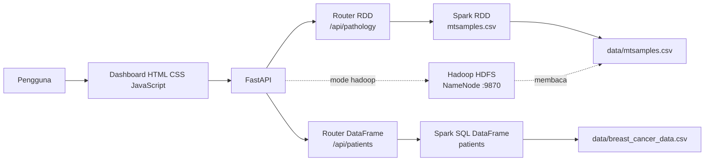
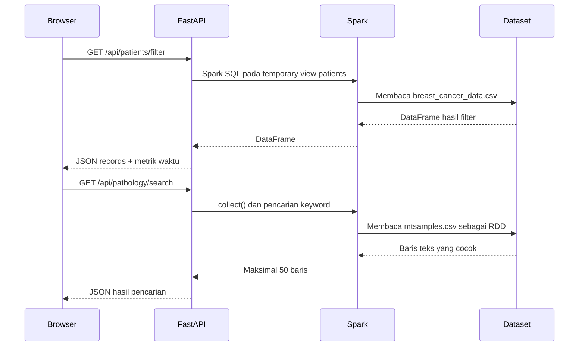
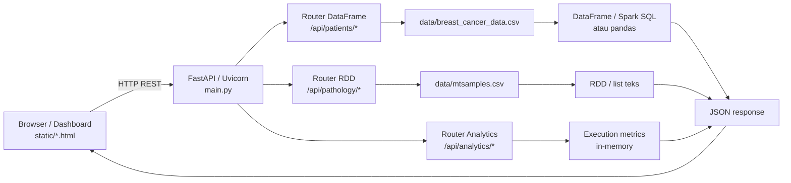
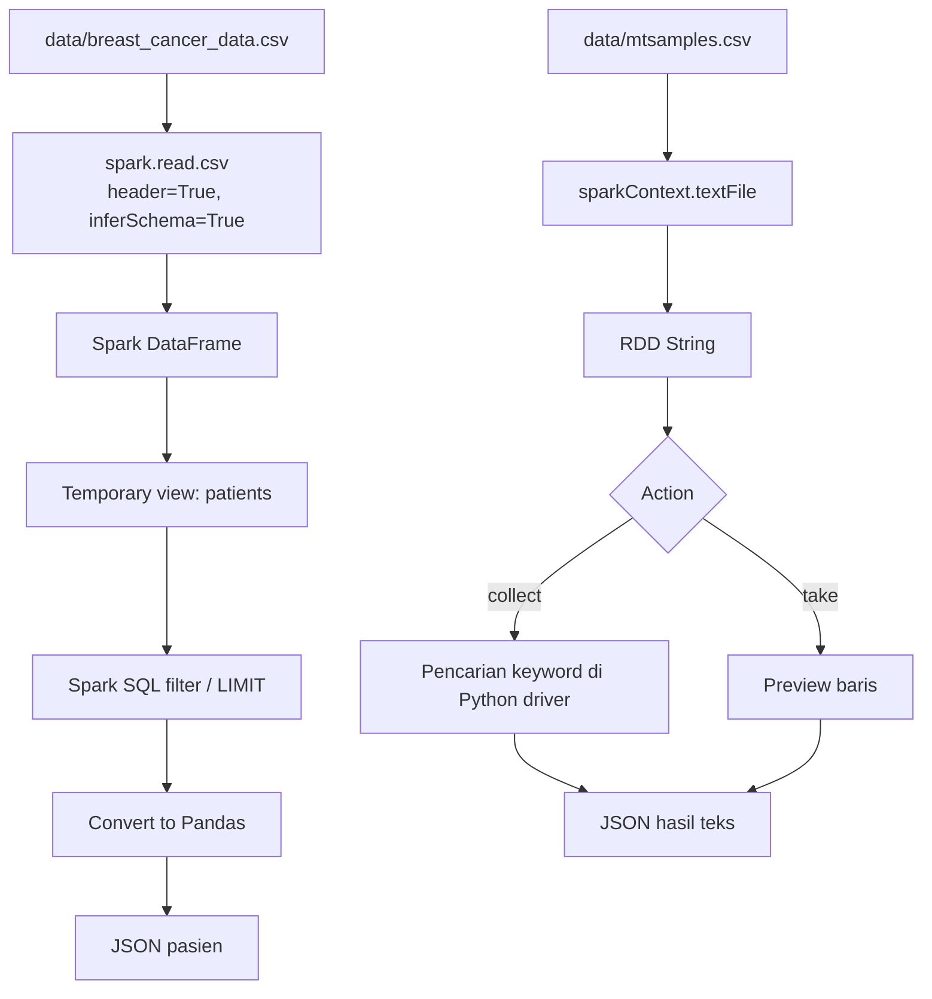
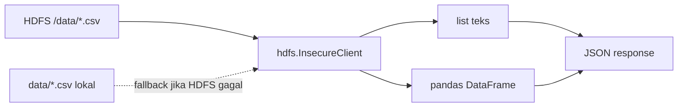
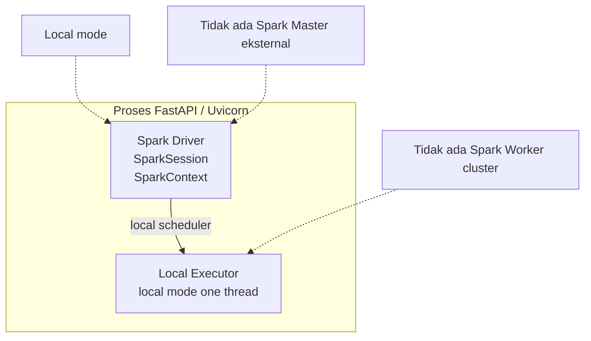
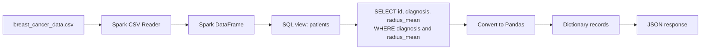
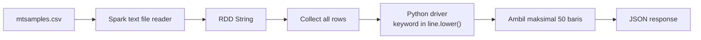
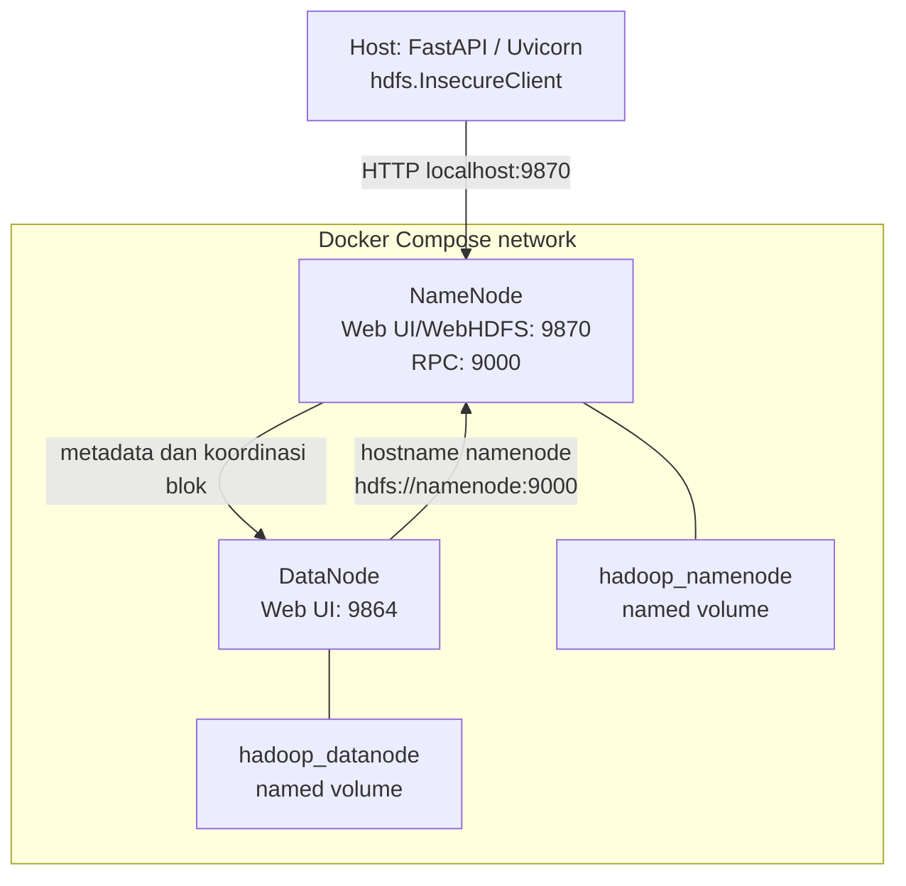
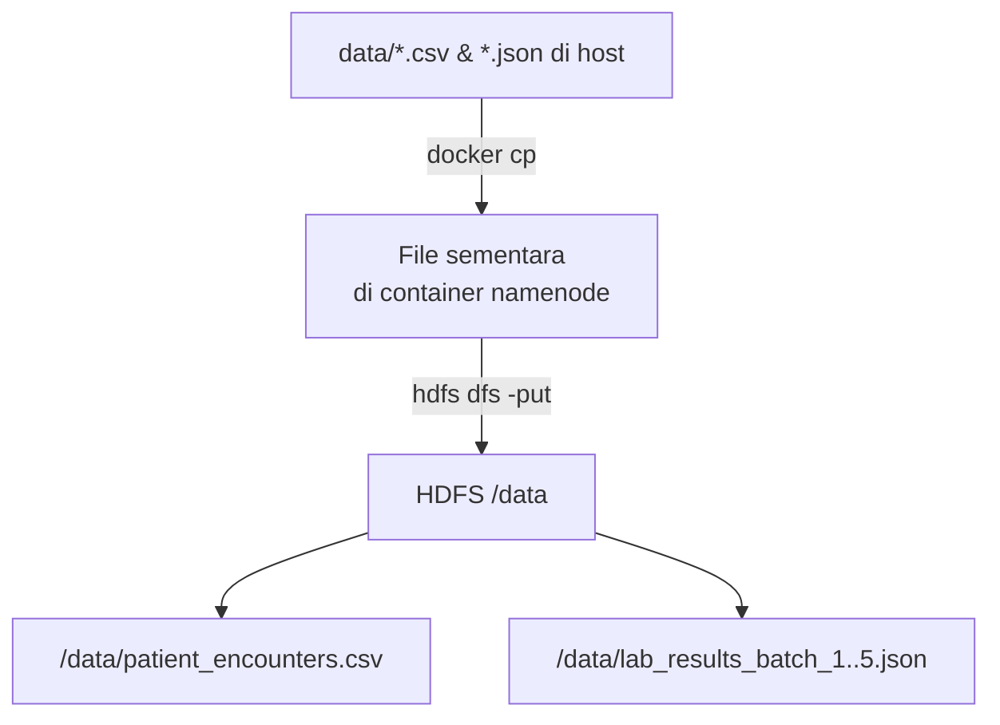

# Hybrid Spark & Hadoop Dashboard — Clinical Laboratory Data Analytics (5Vs of Big Data)

Dashboard analitik data laboratorium klinis berbasis **FastAPI**, **Apache Spark**, dan **Hadoop HDFS** untuk memenuhi tugas **ETS IFB-451 Big Data (A Healthcare Informatics Approach Using the 5Vs of Big Data)**.

Studi kasus yang diangkat adalah **Clinical Laboratory Data Analytics**, yang mengintegrasikan data kunjungan pasien rumah sakit (`data/patient_encounters.csv` — 20.000 baris) dengan 5 *batch* kedatangan hasil pemeriksaan laboratorium (`data/lab_results_batch_1.json` s/d `lab_results_batch_5.json` — total 100.000 rekaman *Nested JSON*).

## Daftar Isi

- [Pembagian Tugas Kelompok (5 Peran ETS IFB-451)](#pembagian-tugas-kelompok-5-peran-ets-ifb-451)
- [Panduan Kode Bagian Big Data Developer](#panduan-kode-bagian-big-data-developer)
- [Arsitektur](#arsitektur)
- [Teknologi](#teknologi)
- [Struktur Proyek](#struktur-proyek)
- [Dataset](#dataset)
- [Prasyarat](#prasyarat)
- [Instalasi](#instalasi)
- [Menjalankan Aplikasi](#menjalankan-aplikasi)
- [Mode Eksekusi](#mode-eksekusi)
- [Halaman Web](#halaman-web)
- [API Reference](#api-reference)
- [Contoh Penggunaan API](#contoh-penggunaan-api)
- [Docker Hadoop HDFS](#docker-hadoop-hdfs)
- [Troubleshooting](#troubleshooting)
- [Catatan Pengembangan](#catatan-pengembangan)
- [Lisensi](#lisensi)

---

## Pembagian Tugas Kelompok (5 Peran ETS IFB-451)

Sesuai pedoman **ETS IFB-451 Big Data (Tabel 7.1 & Tabel 7.2)**, proyek dan video presentasi berdurasi **5 menit** dibagi menjadi **5 peran anggota kelompok** yang saling terhubung dalam satu *workflow* pemrosesan data:

| Segmen | Peran Anggota (*Student Role*) | Modul | Durasi Video | Fokus 5V | Tugas pada Proyek, Demo Video, & Laporan PDF (3 Halaman) |
|---:|---|---:|---:|---|---|
| **1** | **Project Lead / Analyst** | M1 | `0:45` | **All 5Vs** | **1. Pengantar Kasus & Karakteristik Data:**<br/>- Menjelaskan masalah kesehatan (*Clinical Laboratory Data Analytics*) dan pertanyaan utama (*Central Assignment Question*).<br/>- Menunjukkan skala dataset di folder `data/`: `patient_encounters.csv` (20.000 baris) & `lab_results_batch_1..5.json` (100.000 baris, ~30 MB) beserta kompleksitas relasinya (`1-to-Many` melalui `encounter_id`).<br/>- Merangkum bagaimana kelima karakteristik **5V** muncul pada dataset ini.<br/>- **Tugas Laporan PDF:** Menyusun **Halaman 1** (*Project Information, Case Study Title, Group Members, Dataset Description & Source*). |
| **2** | **System Engineer** | M2 | `0:45` | **Volume & Velocity** | **2. Arsitektur Big Data & Aliran Data (*Data Flow*):**<br/>- Menjelaskan desain arsitektur *Hybrid* (**Docker Hadoop HDFS** pada `docker-compose.yml` dengan `namenode:9870` & `datanode:9864`, serta **Apache Spark** + **FastAPI** pada `main.py`).<br/>- Menjelaskan bagaimana arsitektur ini menangani **Volume** (penyimpanan blok HDFS & pemrosesan paralel `local[*]`) dan **Velocity** (aliran *ingestion* 5 *batch* JSON bertahap).<br/>- **Tugas Laporan PDF:** Menyusun **Halaman 3** (*System Architecture Diagram: Data Sources, Ingestion, Storage, Processing, Integration, Analysis & Outputs*). |
| **3** | **Data Engineer** *(Sudah Aktif)* | M3–M4 | `1:00` | **Variety & Veracity** | **3. Penyimpanan, Integrasi Skema, & Kualitas Data:**<br/>- **Storage & Variety:** Mendemonstrasikan pembacaan 2 format berbeda (**CSV** tabular & **Nested JSON** `test_details.*`, `instrument_metadata.*`), proses *flattening* skema JSON di `main.py`, dan penyimpanan di HDFS.<br/>- **Veracity (Data Cleaning & Validation):** Menunjukkan bukti **Before vs After Cleaning** di terminal (`main.py` baris 177–232): penghapusan duplikat CSV & JSON, filter *missing values* (`null`) & nilai error (`-999.0`), serta konversi/standarisasi satuan `mmol/L` & `umol/L` menjadi `mg/dL`.<br/>- **Integration:** Mendemonstrasikan `INNER JOIN` berdasarkan `encounter_id` + validasi *timestamp* (`test_batch_timestamp >= admission_timestamp`) serta menampilkan hasilnya di halaman `/tables` (`static/tables.html`).<br/>- **Tugas Laporan PDF:** Mengisi bagian bukti **Variety & Veracity** pada **Halaman 2**. |
| **4** | **Big Data Developer** *(Ditandai Komentar di Kode)* | M5–M6 | `1:15` | **Volume & Velocity** | **4. Pemrosesan Data & Kompleksitas Komputasi:**<br/>- Membuka komentar (*uncomment*) dan menjalankan kode berlabel `# === [BAGIAN BIG DATA DEVELOPER] ===`.<br/>- **Velocity:** Menunjukkan log pengukuran *ingestion latency* per *batch* (`Batch 1` s/d `Batch 5`) saat data dimuat ke Spark/HDFS.<br/>- **Volume & Computational Complexity:** Menjelaskan optimasi komputasi (`.cache()`, `spark.sql.shuffle.partitions = 4`) serta membandingkan eksekusi query relasional **Spark SQL** (`GET /api/patients/filter` di `routers/dataframe_api.py`) dan pencarian teks **Spark RDD** (`GET /api/pathology/search` di `routers/rdd_api.py`).<br/>- **Performance Reporting:** Menunjukkan grafik perbandingan rata-rata waktu eksekusi (**Spark vs Hadoop**) melalui `routers/analytics_api.py` dan dashboard `static/index.html`.<br/>- **Tugas Laporan PDF:** Mengisi bagian bukti **Volume & Velocity** pada **Halaman 2**. |
| **5** | **Data Analyst** | M7 | `1:15` | **Veracity & Value** | **5. Hasil Analitik & Interpretasi Klinis (*Healthcare Interpretation*):**<br/>- Menjalankan query analitik pada dashboard (`/`) untuk menjawab masalah klinis: mengidentifikasi pasien kondisi kritis di departemen **ICU / ER / Cardiology** dengan nilai hasil lab abnormal (misal *Blood Glucose* tinggi atau status `CRITICAL`).<br/>- Menjelaskan dampak **Veracity** terhadap analisis (mengapa standarisasi satuan `mmol/L` ke `mg/dL` dan penghapusan nilai `-999` sangat krusial agar tidak terjadi salah diagnosis/bias kapasitas RS).<br/>- Menjelaskan **Value** (manfaat hasil analisis untuk perencanaan kapasitas departemen & *laboratory utilisation*) beserta keterbatasan (*limitations*) dari dataset sintetis.<br/>- **Tugas Laporan PDF:** Mengisi bagian bukti **Value**, kesimpulan klinis, dan link YouTube pada **Halaman 2**. |

---

## Panduan Kode Bagian Big Data Developer

Saat ini, bagian **Data Engineer (Segmen 3 — M3–M4)** sudah aktif sepenuhnya, sedangkan bagian **Big Data Developer (Segmen 4 — M5–M6)** sengaja ditandai dengan komentar `# === [BAGIAN BIG DATA DEVELOPER] ===` di dalam kode.

### Daftar File & Baris Kode yang Perlu Diaktifkan oleh **Big Data Developer**

| No | File | Baris / Blok Penanda | Tugas & Fungsi (Modul M5–M6: Volume & Velocity) |
|---:|---|---|---|
| 1 | `main.py` | `# === [BAGIAN BIG DATA DEVELOPER: Modul Pengukuran Performa Komputasi] ===` (Baris 10–16 & 245) | Mengimpor `analytics_api`, menjalankan `analytics_api.initialise_metrics(app)`, dan mendaftarkan `app.include_router(analytics_api.router)`. |
| 2 | `main.py` | `# === [BAGIAN BIG DATA DEVELOPER: Pengukuran Latensi Ingestion (Velocity)] ===` (Baris 46–56) | Mengukur waktu baca (*ingestion latency*) per *batch* (`t0 = time.time()`) saat memuat 5 file JSON dari **Hadoop HDFS**. |
| 3 | `main.py` | `# === [BAGIAN BIG DATA DEVELOPER: Optimasi In-Memory Caching RDD & Pengukuran Velocity] ===` (Baris 151–165) | Mengaktifkan `.cache()` pada `text_rdd`, membaca 5 *batch* JSON secara bertahap dengan `spark.read.json(bf)` + `.unionByName()`, serta mencetak *ingestion latency* per *batch* di terminal untuk bukti **Velocity**. |
| 4 | `routers/dataframe_api.py` | `# [BAGIAN BIG DATA DEVELOPER (M5-M6)]` — Fungsi `filter_patients` (`GET /api/patients/filter`, Baris 10–77) | Menjalankan query pemrosesan relasional **Spark SQL** (`WHERE department = ... AND result_value >= ...`) di atas view `patients`, menghitung waktu eksekusi (`exec_time`), dan mencatatnya dengan `record_execution(request, "filter_data", exec_time)`. |
| 5 | `routers/rdd_api.py` | `# [BAGIAN BIG DATA DEVELOPER (M5-M6)]` — Fungsi `search_keyword` (`GET /api/pathology/search`, Baris 18–65) | Menjalankan operasi pencarian kata kunci pada 100.000 rekaman JSON menggunakan **Spark RDD** (`text_rdd.collect()`), menghitung waktu eksekusi, dan mencatatnya dengan `record_execution(request, "cari_teks", exec_time)`. |
| 6 | `routers/analytics_api.py` | `# [BAGIAN BIG DATA DEVELOPER (M5-M6)]` (Seluruh isi file, Baris 1–49) | Menyimpan riwayat waktu eksekusi di memori dan menyediakan endpoint `GET /api/analytics/execution-summary` untuk menghitung rata-rata waktu eksekusi (*average*) dan waktu terakhir (*latest*) antara **Spark vs Hadoop**. |
| 7 | `static/index.html` | `<!-- [BAGIAN BIG DATA DEVELOPER (M5-M6)] -->` (Baris 168–244 & Baris 382–385) | Menampilkan UI **Dashboard Analitik Waktu Eksekusi (Spark vs Hadoop)**, kartu **Filter Utilisasi & Hasil Lab (DataFrame SQL Join)**, kartu **Pencarian Log Instrumen & Batch JSON Lab (RDD)**, serta mengaktifkan kembali pemanggilan `loadExecutionAnalytics()`, `fetchPatients()`, dan `searchKeyword()` pada `window.onload`. |

## Arsitektur

### Diagram komponen



### Alur pemrosesan



## Analisis Arsitektur Proyek

### 1. Arsitektur Umum dan Alur Data

Struktur utama proyek adalah:

```text
.
├── data/
│   ├── breast_cancer_data.csv   # Data kanker tabular
│   └── mtsamples.csv            # Laporan patologi berbasis teks
├── routers/
│   ├── dataframe_api.py         # Endpoint DataFrame/Spark SQL
│   ├── rdd_api.py               # Endpoint RDD/pencarian teks
│   └── analytics_api.py         # Metrik waktu eksekusi
├── static/
│   ├── index.html               # Dashboard utama
│   └── tables.html              # Preview data mentah
├── main.py                      # Entry point FastAPI dan pemilih mode
├── docker-compose.yml           # Infrastruktur Hadoop HDFS
└── README.md
```

Komponen aplikasi dan aliran datanya:



- `breast_cancer_data.csv` berisi data terstruktur dengan kolom seperti
  `id`, `diagnosis`, `radius_mean`, dan fitur tumor lainnya.
- `mtsamples.csv` berisi laporan patologi, transkripsi, spesialisasi medis,
  dan keywords.
- `main.py` membuat aplikasi FastAPI, membaca `EXEC_MODE`, lalu menginisialisasi
  Spark atau koneksi HDFS.
- `dataframe_api.py` menangani filter diagnosis/radius dan preview pasien.
- `rdd_api.py` menangani pencarian keyword dan preview baris laporan patologi.
- `analytics_api.py` menyimpan jumlah, rata-rata, dan waktu eksekusi terakhir
  secara in-memory selama proses aplikasi berjalan.

Pada mode Spark, aliran input lokalnya adalah:



Pada mode Hadoop, aplikasi membaca dataset dari HDFS. Jika HDFS tidak dapat
diakses, `main.py` menggunakan file lokal di `data/` sebagai fallback:



### 2. Arsitektur Pemrosesan Mode Spark

Mode Spark diaktifkan dengan `EXEC_MODE=spark`. `main.py` membuat
`SparkSession` menggunakan `local[1]`, sehingga Spark berjalan pada satu
mesin dan satu thread komputasi:



Tidak ada Spark Master eksternal, Spark Worker, atau executor terpisah pada
repository ini. Dengan kata lain, `local[1]` adalah local mode, bukan Spark
cluster deployment.

#### Alur DataFrame dan Spark SQL

1. `spark.read.csv(..., header=True, inferSchema=True)` membaca
   `breast_cancer_data.csv`.
2. Data dibentuk menjadi Spark DataFrame.
3. DataFrame didaftarkan sebagai temporary view bernama `patients`.
4. Endpoint `/api/patients/filter` menjalankan query SQL untuk memfilter
   `diagnosis` dan `radius_mean`.
5. Endpoint memanggil `toPandas()`, mengubah hasil ke dictionary, lalu
   mengembalikannya sebagai JSON.



#### Alur RDD

1. `spark.sparkContext.textFile("data/mtsamples.csv")` membuat
   `RDD[String]`.
2. `/api/pathology/all` menggunakan `take(limit)`.
3. `/api/pathology/search` menggunakan `collect()`, kemudian pencarian
   keyword dilakukan oleh Python driver.
4. Hasil pencarian dibatasi maksimal 50 baris.



Implementasi pencarian saat ini belum menggunakan transformasi
`text_rdd.filter(...)`; seluruh baris dikumpulkan ke driver terlebih dahulu.
Karena itu pendekatan ini cocok untuk demonstrasi, tetapi kurang ideal untuk
dataset teks yang sangat besar.

### 3. Infrastruktur Hadoop melalui Docker Compose

`docker-compose.yml` hanya mendefinisikan dua service HDFS:

| Service | Peran | Port host |
|---|---|---|
| `namenode` | Metadata HDFS, RPC, dan Web UI/WebHDFS | `9870`, `9000` |
| `datanode` | Penyimpanan blok data HDFS | `9864` |

Tidak ada YARN ResourceManager, NodeManager, Hadoop History Server, Spark
Master, atau Spark Worker dalam Compose ini. Jadi konfigurasi tersebut adalah
HDFS minimal, bukan cluster Hadoop lengkap berbasis YARN.



Detail komunikasi:

- Kedua container berada pada network default Docker Compose.
- `datanode` menemukan NameNode melalui hostname `namenode`.
- `CORE_CONF_fs_defaultFS=hdfs://namenode:9000` menetapkan NameNode sebagai
  filesystem default.
- `SERVICE_PRECONDITION=namenode:9870` membuat DataNode menunggu NameNode
  siap.
- Named volume `hadoop_namenode` menyimpan metadata NameNode.
- Named volume `hadoop_datanode` menyimpan blok data DataNode.
- Folder host `data/` tidak otomatis dimount ke container dan tidak otomatis
  masuk HDFS.

Dataset harus dimasukkan ke HDFS secara manual, misalnya:



Contoh perintah:

```powershell
docker exec namenode hdfs dfs -mkdir -p /data
docker cp data\patient_encounters.csv namenode:/tmp/patient_encounters.csv
docker exec namenode hdfs dfs -put -f /tmp/patient_encounters.csv /data/

for ($i=1; $i -le 5; $i++) {
    docker cp "data\lab_results_batch_$i.json" "namenode:/tmp/lab_results_batch_$i.json"
    docker exec namenode hdfs dfs -put -f "/tmp/lab_results_batch_$i.json" /data/
}
```

Dalam mode Hadoop, `InsecureClient("http://localhost:9870", user="root")`
membaca file melalui NameNode/WebHDFS. NameNode mengelola metadata dan lokasi
blok, sedangkan isi blok disimpan oleh DataNode. Setelah dibaca, pemrosesan
berlangsung di memori proses FastAPI menggunakan list Python dan pandas; tidak
ada job MapReduce atau Spark-on-YARN.

## Teknologi

| Komponen | Peran |
|---|---|
| Python | Bahasa pemrograman utama |
| FastAPI | REST API dan routing |
| Uvicorn | Application server ASGI |
| PySpark | Pemrosesan DataFrame, Spark SQL, dan RDD |
| Hadoop HDFS | Penyimpanan/akses data terdistribusi opsional |
| `hdfs` | Client Python untuk HDFS |
| HTML, CSS, JavaScript | Dashboard frontend |
| Docker Compose | Menjalankan NameNode dan DataNode |

## Struktur Proyek

```text
.
├── data/
│   ├── patient_encounters.csv       # Data kunjungan pasien RS (20.000 baris CSV)
│   └── lab_results_batch_1..5.json  # 5 Batch hasil lab klinis (100.000 baris Nested JSON)
├── routers/
│   ├── dataframe_api.py             # Endpoint Spark SQL/DataFrame
│   ├── rdd_api.py                   # Endpoint Spark RDD
│   └── analytics_api.py             # Endpoint metrik rata-rata waktu eksekusi
├── static/
│   ├── index.html                   # Dashboard analitik 5V
│   └── tables.html                  # Preview data terintegrasi & JSON mentah
├── docker-compose.yml               # Konfigurasi Hadoop HDFS
├── main.py                          # Inisialisasi FastAPI dan pipeline Spark/HDFS
└── README.md
```

## Dataset

### 1. `data/patient_encounters.csv` (Tabular CSV — ~20.000 Baris)

Dataset kunjungan pasien rumah sakit dengan kolom utama:
- `encounter_id`: ID unik kunjungan pasien (kunci relasi *join*);
- `patient_id`: ID pasien;
- `age`, `gender`: Demografi pasien;
- `department`: Departemen layanan (`ICU`, `ER`, `Cardiology`, `Inpatient`, `Outpatient`);
- `admission_timestamp`: Waktu masuk pasien;
- `diagnosis_code`: Kode diagnosis klinis (ICD-10).

### 2. `data/lab_results_batch_1.json` s/d `lab_results_batch_5.json` (Nested JSON Lines — 100.000 Baris)

Lima *batch* kedatangan hasil pemeriksaan laboratorium klinis (masing-masing 20.000 baris) dengan struktur bersarang (*nested schema*):
- `lab_record_id`, `encounter_id`, `test_batch_timestamp`;
- `test_details`: `{ "test_name", "result_value", "unit", "reference_range" }`;
- `instrument_metadata`: `{ "analyzer_id", "status" }`.

Dataset ini juga memuat tantangan **Veracity** nyata (baris duplikat, *missing values*, nilai error `-999.0`, serta satuan `mmol/L` dan `umol/L` yang harus distandarisasi ke `mg/dL`) yang dibersihkan dan diintegrasikan dengan `patient_encounters.csv` menjadi temporary view `patients`.

## Prasyarat

- Python 3.10+;
- Java yang kompatibel dengan versi PySpark yang digunakan;
- Apache Spark/PySpark;
- Docker Desktop dan Docker Compose, hanya jika ingin menjalankan HDFS;
- Windows: konfigurasi Spark lokal dapat memerlukan `winutils` sesuai versi
  Hadoop yang dipakai.

Repository belum menyediakan `requirements.txt`. Instal dependensi Python
secara manual:

```powershell
python -m venv venv
.\venv\Scripts\Activate.ps1
python -m pip install --upgrade pip
pip install fastapi uvicorn pyspark hdfs
```

Jika PowerShell menolak aktivasi environment, jalankan:

```powershell
Set-ExecutionPolicy -Scope Process -ExecutionPolicy Bypass
.\venv\Scripts\Activate.ps1
```

## Instalasi

1. Clone repository dan masuk ke direktori proyek.
2. Buat serta aktifkan virtual environment.
3. Instal dependensi Python seperti pada bagian [Prasyarat](#prasyarat).
4. Pastikan dataset tersedia di direktori `data/`.
5. Untuk penggunaan mode Spark, ubah konfigurasi berikut di `main.py`:

   ```python
   EXEC_MODE = "spark"
   ```

## Menjalankan Aplikasi

Jalankan server dari root repository:

```powershell
python -m uvicorn main:app --reload
```

Buka halaman berikut di browser:

- Dashboard: <http://localhost:8000/>
- Tabel data: <http://localhost:8000/tables>
- Dokumentasi Swagger: <http://localhost:8000/docs>
- Dokumentasi ReDoc: <http://localhost:8000/redoc>

Spark dijalankan dalam `local[1]` agar lebih stabil pada Windows. Konfigurasi
Arrow juga dimatikan di `main.py` untuk menghindari masalah konversi Pandas.

## Mode Eksekusi

### Mode `spark`

Mode ini:

1. membuat `SparkSession` lokal;
2. memuat `data/mtsamples.csv` sebagai `text_rdd`;
3. memuat `data/breast_cancer_data.csv` sebagai DataFrame;
4. membuat temporary view SQL bernama `patients`;
5. mengaktifkan endpoint DataFrame dan RDD.

Gunakan mode ini untuk menjalankan dashboard secara lengkap.

### Mode `hadoop`

Mode ini membuat `InsecureClient` ke:

```text
http://localhost:9870
```

dan mencoba membaca `/data/mtsamples.csv` dari HDFS. Dataset harus sudah
tersedia di HDFS. Pada implementasi saat ini, mode ini belum membuat
`SparkSession` dan `text_rdd`, sehingga endpoint analitik dashboard belum dapat
digunakan sepenuhnya tanpa pengembangan lanjutan pada `main.py`.

## Halaman Web

### Dashboard utama `/`

Dashboard memiliki dua panel:

1. **Filter Rekam Medis (DataFrame)**  
   Memfilter pasien berdasarkan diagnosis dan batas minimum `radius_mean`.
2. **Pencarian Teks Patologi (RDD)**  
   Mencari keyword pada baris laporan patologi dan menampilkan maksimal 50
   hasil.

Kedua panel otomatis memuat data ketika halaman dibuka.

### Tabel data `/tables`

Menampilkan:

- maksimal 100 baris data pasien dari endpoint DataFrame;
- maksimal 100 baris data laporan patologi dari endpoint RDD.

## API Reference

Semua endpoint mengembalikan JSON. Jika terjadi kegagalan pemrosesan, API
mengembalikan HTTP `500` dengan field `detail`.

### DataFrame API

#### `GET /api/patients/filter`

Parameter query:

| Parameter | Tipe | Default | Keterangan |
|---|---|---:|---|
| `min_radius` | float | `20.0` | Nilai minimum `radius_mean` |
| `diag_type` | string | `M` | Diagnosis, umumnya `M` atau `B` |

Response berisi `execution_time_sec`, `total_found`, dan `data`.

#### `GET /api/patients/all`

Parameter query:

| Parameter | Tipe | Default | Keterangan |
|---|---|---:|---|
| `limit` | integer | `100` | Jumlah baris maksimum |

Response berisi `columns` dan `data`.

### RDD API

#### `GET /api/pathology/search`

Parameter query:

| Parameter | Tipe | Default | Keterangan |
|---|---|---:|---|
| `keyword` | string | `cancer` | Teks yang dicari tanpa membedakan kapitalisasi |

Response berisi `execution_time_sec`, `keyword`, dan maksimal 50 baris pada
`data`.

#### `GET /api/pathology/all`

Parameter query:

| Parameter | Tipe | Default | Keterangan |
|---|---|---:|---|
| `limit` | integer | `100` | Jumlah baris maksimum |

Response berisi `data` berupa baris teks.

## Contoh Penggunaan API

```powershell
# Filter pasien malignant dengan radius minimum 20
curl "http://localhost:8000/api/patients/filter?min_radius=20&diag_type=M"

# Ambil 10 baris data pasien
curl "http://localhost:8000/api/patients/all?limit=10"

# Cari keyword pada laporan patologi
curl "http://localhost:8000/api/pathology/search?keyword=tumor"

# Ambil 20 baris pertama RDD
curl "http://localhost:8000/api/pathology/all?limit=20"
```

## Docker Hadoop HDFS

Jalankan cluster HDFS:

```powershell
docker compose up -d
docker compose ps
```

Antarmuka NameNode tersedia di <http://localhost:9870>. Untuk memasukkan
dataset ke HDFS, gunakan shell container NameNode:

```powershell
docker exec -it namenode bash
mkdir -p /data
hdfs dfs -put -f /path/di/container/mtsamples.csv /data/mtsamples.csv
hdfs dfs -ls /data
exit
```

Perintah `hdfs dfs -put` harus dijalankan terhadap file yang memang tersedia
di dalam container. Jika file masih berada di host, salin terlebih dahulu
dengan `docker cp`.

Hentikan layanan HDFS dengan:

```powershell
docker compose down
```

## Troubleshooting

### `AttributeError: 'State' object has no attribute 'spark'`

Pastikan `EXEC_MODE = "spark"` di `main.py`, lalu restart Uvicorn.

### `Java gateway process exited before sending its port number`

Periksa instalasi Java dan variabel `JAVA_HOME`. Pastikan versi Java cocok
dengan PySpark yang terpasang dan jalankan ulang virtual environment.

### HDFS tidak dapat diakses di port `9870`

Pastikan container berjalan:

```powershell
docker compose ps
docker compose logs namenode
```

Pastikan juga port `9870` tidak sedang digunakan aplikasi lain.

### Hasil API terlalu besar atau proses lambat

Gunakan parameter `limit` untuk endpoint `/all`. Endpoint pencarian RDD
mengumpulkan data dengan `collect()` dan membatasi response menjadi 50 baris,
tetapi tetap dapat memakai memori besar jika dataset bertambah signifikan.

## Catatan Pengembangan

- `main.py` saat ini menyimpan pilihan mode secara hard-coded melalui
  `EXEC_MODE`; konfigurasi environment variable dapat ditambahkan untuk
  deployment yang lebih fleksibel.
- Query DataFrame dibangun dari parameter request. Untuk penggunaan produksi,
  tambahkan validasi input dan gunakan pendekatan yang menghindari interpolasi
  SQL langsung.
- `toPandas()` cocok untuk preview berukuran kecil, bukan untuk mengirim
  keseluruhan dataset berukuran besar.
- File `__pycache__` dan environment lokal sebaiknya tidak di-commit ke
  repository.
- Tambahkan `requirements.txt` atau `pyproject.toml` agar instalasi dependency
  dapat direproduksi.

## Lisensi

Repository ini belum menyertakan berkas lisensi. Tambahkan lisensi proyek
secara eksplisit sebelum digunakan atau didistribusikan di luar kebutuhan
internal/pembelajaran.
